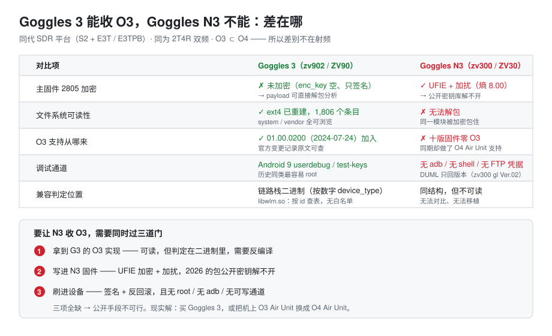

# dji-goggles-o3-compat

**中文** | [English](README.en.md)

**大疆 Goggles 3 为什么能收 O3 Air Unit、Goggles N3 为什么不能——以及"让 N3 也支持 O3"到底可不可行。**

一份基于**原厂固件 + 真机探测**的实测记录。所有结论都有可复现的步骤和原始字节。

> 本仓库**不包含、也不再分发任何大疆固件或其提取产物**（体积与版权原因）。
> 只提供方法、脚本、证据片段与结论。固件请自行通过 DJI Assistant 2 获取。

---

## 一句话结论

| 问题 | 答案 |
|---|---|
| G3 凭什么能收 O3 | 2024-07-24 的一次固件更新在 G3 的 Android 用户态里加进了 O3 链路支持（官方清单原文：`Added support to use with DJI O3 Air Unit`） |
| N3 为什么不能 | 硬件不是瓶颈（同代 S2/E3T 平台、2T4R 双频、O3 ⊂ O4）；DJI 从 2024-11 到 2026-10 的 **10 个固件版本一次都没做 O3**，期间还专门做了 O4 Air Unit 支持 |
| 能改吗 | **公开手段下不能**。三重门：固件加密（`UFIE` + 加扰）、签名与反回滚、无 root/adb/可写调试通道 |



---

## 证据链

### 1. 官方更新清单（DJI Assistant 2 本地缓存）

Assistant 会把每个产品的版本历史缓存在
`<安装目录>\DJIEngine\DJIData\firm_cache\*.cache`（JSON）。

**Goggles 3（zv902）**

| 版本 | 日期 | 内容 |
|---|---|---|
| 01.00.0100 | 2024-04-07 | 优化眼镜与遥控器通信稳定性 |
| **01.00.0200** | **2024-07-24** | **Added support to use with DJI O3 Air Unit** |
| 01.00.0300 | 2024-09-05 | Added support to use with DJI Neo |

**Goggles N3（zv300）** — 10 个版本，O3 零提及：

| 版本 | 日期 | 内容 |
|---|---|---|
| 01.00.0200 | 2024-11-05 | Avata 2 支持、Neo 稳像 |
| 01.00.0300 | 2025-01-07 | **O4 Air Unit / Pro** |
| 01.00.0400 | 2025-03-05 | O4 的 INAV OSD |
| 01.00.0500 | 2025-07-25 | 锁屏设置 |
| 01.00.0600 | 2025-10-29 | Neo 2 |
| 01.00.0900 | 2026-03-26 | Avata 360 |
| 01.00.1000 / 1100 / 1300 | 2026-06 → 10-19 | 修问题 |

> 媒体当年多写成"v01.00.0300 加入 O3"，DJI 自己的清单是 **01.00.0200（2024-07-24）**，
> 0300 那次加的是 Neo。日期一致，同一次更新。

### 2. 固件包结构：G3 可读，N3 加密

两个包都是 `tar → 若干模块 → IMaH → Android OTA`，但主固件的加密状态不同：

| | G3 主固件 `2805` | N3 主固件 `2805` |
|---|---|---|
| `type` | `ZV90` | `ZV30` |
| `enc_key` | **空** | `UFIE` |
| `scramble_key` | 全 0 | 非零（16 字节） |
| `auth_alg` | 3（只签名） | 262147 |
| payload | 明文 Android OTA（可解） | 密文（熵 8.00） |

模块编号两边完全一致：`0000`(CNFG 清单) / `1403`(GFSK) / `2803`(CPLD) / `2805`(主固件)。
这就是"社区能研究 G3、研究不动 N3"的第一性原因——不是权限，是**同一模块换了加密壳**。

详见 [docs/firmware-format.md](docs/firmware-format.md)。

### 3. G3 系统镜像可完整重建并浏览

`system.new.dat.br` + `system.transfer.list`(v4) → ext4 镜像，1,806 个条目。
关键点：**transfer list 的区间是 end 独占**（`blocks = end - start`），
搞错一位就对不上数据长度（123,004 块 × 4096 = 503,824,384 B，与 `system.new.dat` 一字节不差）。

读出来的关键文件：

```text
/etc/device_table.json   device_name "E3T_ZV902", device_type "GLASS", host_type "MASTER"
/etc/wlm_cfg.json        无线链路配置：product "ZV902", soc "e3t",
                         libwlm_module_id 0x0e07, sdr_agent 0x0e00,
                         modules: ds_master/link_sw/link_state/dev_mgr/agt_mgr…
/lib64/libwlm.so         无线链路主体
/bin/dji_glasses         眼镜主服务
/bin/dji_gfsk_agent      2.4G 信令
/lib/modules/dji_wl.ko   无线内核模块
OTA metadata             e3t/e3t_zv902:9/PD1A.180720.031/13497:userdebug/test-keys
```

**兼容判定不在任何明文表里**：全镜像扫 `wm1695` / `O3AU` / `ocusync` 均 0 命中；
`airunit` 只命中协议字段名（`FlycontrolAirUnitStatusArmFlightMode`）和 UI 菜单。
判定逻辑埋在链路栈二进制里，按**数字 device_type** 走。

详见 [docs/filesystem.md](docs/filesystem.md)。

### 4. 链路库静态分析：没有白名单，只有数字 id

`libwlm.so`（AArch64，未 strip 动态符号）解析出 477 个函数。关键的一条：

```asm
; wlm_get_product_model_num
adrp  x8, #0x6f000
ldr   x8, [x8, #0xb28]     ; 重定位后的表指针
and   w9, w0, #0xff
ldrb  w0, [x8, w9, uxtw]   ; return table[idx] —— 单字节
ret
```

机型身份 = **字节表 + 下标**，不是字符串比较。链路库负责：
字符串→模块 id（`switch_str_to_module_id`）、开链路（`libwlm_link_channel_active`）、
维护对端设备表（`wlm_share_info_read_dev_info`）。它**执行**链路策略，
不判断"这副眼镜允许连谁"。全库 1,804 条可打印字符串里 `o3/o4/wm1695/ocusync` 均为 0。

详见 [docs/link-stack.md](docs/link-stack.md)。

### 4. N3 真机探测：只给"读版本"

接上 N3（VID `2CA3` / PID `0020`）后：

| 通道 | 结果 |
|---|---|
| RNDIS 网络 `192.168.60.2` | ping 通；只开 21 端口 |
| FTP 21 | `220 Hello!`，匿名与常见口令全部 `530` |
| USB 大容量存储 | 只映射 SD 卡（`Linux File-Stor Gadget`） |
| adb (5555) / SSH / HTTP | 全关，USB 侧也没有 adb 接口 |
| **DUML（厂商 bulk 通道）** | **只有单向广播**：写入不产生应答，接口 3/5/6/7 干脆拒写 |

DUML 广播包（interface 4，EP `0x04`/`0x85`，约每 0.3 s 一条，cmd `0x82`）：

```text
55 2b 04 58 3c 0a 00 00 80 00 01 00 12
  7a 76 33 30 30 20 67 6c 20 56 65 72 2e 30 32     ← "zv300 gl Ver.02"
  00 0f 43 00 0a 0f 43 00 0a 01 00 00 c0 7c e3
```

型号 `ZV300`，版本串 `zv300 gl Ver.02`，版本字段 `0x0F43 / 0x000A`。
`GENERAL cmd 0x02…0x0C` 全部无应答，只有 `0x82` 心跳。

详见 [docs/device-probe.md](docs/device-probe.md)。

---

## 可行性判定：三重门

要让 N3 收 O3，必须同时过：

1. **拿到 G3 的 O3 实现** —— G3 固件不加密，可以读；但兼容判定在二进制里，需要逆向
2. **写进 N3** —— N3 主固件 `UFIE` 加密 + 加扰，公开密钥库最新只到 2021，2026 的包解不开
3. **刷进去** —— 签名 + 反回滚；N3 无 root、无 adb、无 shell

三项全缺 → **公开手段下不可行**。

现实解只有两个：**买 Goggles 3 收 O3**，或**把机上的 O3 Air Unit 换成 O4 Air Unit**（N3 官方支持）。

---

## 复现

### 依赖

```bash
pip install pycryptodome brotli pyusb
git clone https://github.com/o-gs/dji-firmware-tools.git   # 固件容器解析参考实现
```

### 1. 看固件包结构（tar + IMaH 头）

```bash
python tools/imah_tar.py V01.00.0200_zv902_dji_system.bin
```

输出每个 tar 成员、主模块的 `name/type/enc_key/auth_key/payload_size`。
`enc_key` 为空 = 未加密，可以直接往下解。

### 2. 重建 ext4 系统镜像

```bash
# 先 brotli 解压
python -c "import brotli,sys;open('system.new.dat','wb').write(brotli.decompress(open('system.new.dat.br','rb').read()))"

# transfer list v4 -> ext4（注意 end 独占）
python tools/sdat2img_v4.py system.transfer.list system.new.dat system.img
```

### 3. 浏览文件系统（纯 Python，无需 mount）

```bash
python tools/ext4_read.py system.img ls /
python tools/ext4_read.py system.img cat /etc/wlm_cfg.json
```

### 4. 探测 N3 的 DUML

```powershell
# 需要 64 位 libusb0.dll（libusb-win32 1.4.0.2 amd64）
python tools/duml_probe.py --dll C:\path\to\libusb0.dll --iface 4
```

---

## 目录

```text
docs/firmware-format.md   固件容器的分层结构与两机差异（含 hexdump）
docs/filesystem.md        ext4 重建的坑、文件清单、wlm_cfg 摘录
docs/link-stack.md        libwlm.so 静态分析：符号、反汇编、它管什么不管什么
docs/n3-followup.md       N3 侧继续深挖：GFSK 明文固件分析、6 把 UFIE 密钥全试失败
docs/debug-surface.md      调试面盘点：ro.debuggable=1、服务 root、启动链 TBIE 加密、SD 卡工程开关
docs/device-probe.md      USB/RNDIS/FTP/DUML 探测全过程
docs/assets/compat.svg    一页纸对比图
docs/announcement.md      发布用文案（英文 Reddit/rcgroups + 中文版，可直接粘贴）
evidence/                 原始证据：版本历史 JSON、头 hexdump、符号表、DUML 会话、wlm_cfg 原文
tools/imah_tar.py         tar 成员 + IMaH 头解析
tools/sdat2img_v4.py      Android block-OTA transfer list v4 -> ext4
tools/ext4_read.py        最小 ext4 读取器（ls / cat / find，支持稀疏文件）
tools/duml_probe.py       DUML 握手与命令探测
```

---

## 声明

- 仅用于**互操作性与设备兼容性研究**，分析对象是本人合法持有的设备与其公开下发的固件。
- 仓库不含任何大疆固件、密钥或绕过签名的实现。
- 未对设备做任何写入操作；所有探测均为只读。
- `DJI`、`Goggles`、`O3/O4 Air Unit` 等为大疆创新商标，本项目与其无隶属关系。

## 参考

- [DJI Goggles N3 官方参数](https://www.dji.com/cn/goggles-n3/specs)
- [DJI Goggles 3 固件说明（O3 支持）](https://droneland.be/blog/dji-goggles-3-firmware-update-25-07-2024)
- [O3 与 O4 图传差异（2T2R → 2T4R、60MHz/60Mbps）](https://www.heliguy.com/blogs/knowledge-base/compared-to-the-o3-video-transmission-of-dji-avata-what-are-the-improvements-of-the-o4-video-transmission-of-dji-avata-2/)
- [Goggles N3 拆机（4 天线、S2/E3T 平台）](https://greyarro.ws/t/dji-goggles-n3-rumours-leaks-gossip-and-general-discussion/85405/51)
- [dji-firmware-tools](https://github.com/o-gs/dji-firmware-tools)
- [DankDroneDownloader](https://github.com/cs2000/DankDroneDownloader)
